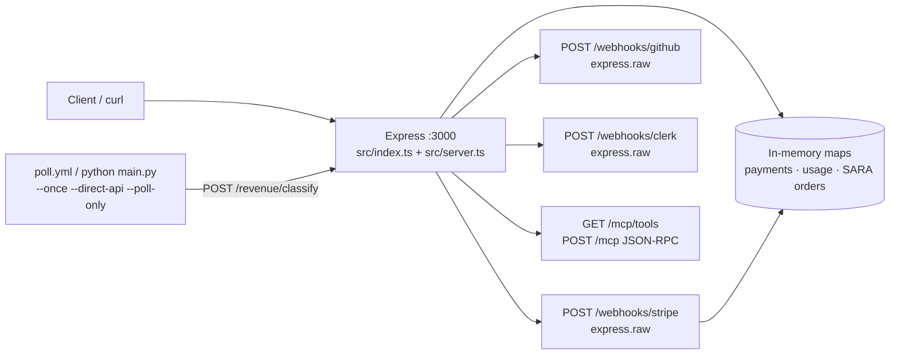

# 💳 OpenClaw Revenue Engine

[](https://github.com/donny-devops/openclaw-revenue-engine/actions)
[](https://codecov.io/gh/donny-devops/openclaw-revenue-engine)
[](https://github.com/donny-devops/openclaw-revenue-engine/releases)
[](LICENSE)

## Intent

Express HTTP API that classifies paid inbound work, creates Stripe (or simulated) Checkout sessions, meters usage, exposes MCP tools, and tracks seller-side SARA Plus orders. A separate Python poller can pull a Moltgate inbox and POST into `/revenue/classify`.

This checkout is **not** a Grafana stack, **not** an SQS/Redis worker, and **not** an OpenClaw gateway on `:18789`. There is **no** `docker-compose.yml`. Payments, usage events, Stripe event ids, Clerk event ids, and SARA Plus orders live in **in-memory maps** and vanish on process restart. `pg` and `ioredis` are unused under `src/`.

---

## Architecture



- Listen port is `PORT`, default **3000** (`src/server.ts`). Dockerfile is `node:26-alpine`, `EXPOSE 3000`, healthcheck `GET /health`.
- Webhook routes are mounted with `express.raw` **before** `express.json()`.
- `revenueRouter.use('/sara-plus', saraPlusRouter)` is registered **before** operator auth. SARA Plus paths still exist even though `GET /` does not list them.

---

## Quickstart

Full CI uses **Node 22.x**. Import-time `requireEnv` in the Stripe and GitHub webhook modules needs non-empty `STRIPE_SECRET_KEY`, `STRIPE_WEBHOOK_SECRET`, and `GITHUB_WEBHOOK_SECRET` or the process throws on boot.

```bash
git clone https://github.com/donny-devops/openclaw-revenue-engine.git
cd openclaw-revenue-engine
cp .env.example .env
# Set at least STRIPE_SECRET_KEY, STRIPE_WEBHOOK_SECRET, GITHUB_WEBHOOK_SECRET.
# Placeholder / sk_test_ keys are fine outside production (simulated checkout).

npm ci
npm run dev
```

```bash
curl -s http://localhost:3000/health
# {"status":"ok","timestamp":"..."}

curl -s http://localhost:3000/
# Index lists /health, /revenue/summary, /revenue/lanes, /revenue/services,
# /revenue/agents, /revenue/checkout, /revenue/earnings, /usage/summary,
# /mcp, /revenue/openclaw. It does NOT list SARA Plus paths.
```

Do **not** run `docker compose up`. That file is not in this repository.

---

## Public HTTP API

Base URL: `http://localhost:3000`. JSON body limit is 1mb. Global limiter is **100 req / 60s**; webhook limiter is **30 req / 60s** (`express-rate-limit` in `src/index.ts`). `.env.example` `RATE_LIMIT_*` values are unused.

Operator auth (`src/middleware/auth.ts`): `Authorization: Bearer $OPERATOR_API_KEY` or a JWT signed with `JWT_SECRET`. If **both** are unset: non-production allows the request; production returns **503**.

| Method | Path | Auth | Notes |
|--------|------|------|--------|
| `GET` | `/` | public | Index. Does **not** list SARA Plus paths. |
| `GET` | `/health` | public | `{ status, timestamp }` |
| `GET` | `/revenue/summary` | public | Catalog summary + live earnings snapshot |
| `GET` | `/revenue/lanes` | public | Enabled lanes from `config/lanes.json` |
| `GET` | `/revenue/services` | public | Enabled services from `config/services.json` |
| `GET` | `/revenue/agents` | public | Enabled agents from `config/agentic-ai.json` |
| `GET` | `/revenue/openclaw` | public | `config/openclaw.json` |
| `POST` | `/revenue/classify` | public | Classify a paid request into lane + service |
| `POST` | `/revenue/checkout` | public | Stripe or simulated Checkout; `customer_email` required |
| `GET` | `/revenue/sara-plus/workflow` | public | Seller-side checklist (not on `GET /`) |
| `POST` | `/revenue/sara-plus/handoff-draft` | public | Draft SMS/email copy without collecting secrets |
| `POST` | `/revenue/sara-plus/review-action` | operator | Allowed seller work vs blocked PII/bypass |
| `GET` | `/revenue/sara-plus/orders` | operator | List orders; `?reminders=true&stale_minutes=` |
| `POST` | `/revenue/sara-plus/orders` | operator | Create tracked seller order |
| `GET` | `/revenue/sara-plus/orders/:id` | operator | Fetch one order |
| `PATCH` | `/revenue/sara-plus/orders/:id` | operator | Update order |
| `GET` | `/revenue/earnings` | operator | Collected / pending snapshot |
| `GET` | `/revenue/payments` | operator | In-memory payment list |
| `GET` | `/revenue/payments/:id` | operator | One payment |
| `POST` | `/revenue/payments/:id/collect` | operator | Simulated collect; registered **only** when `NODE_ENV !== 'production'` |
| `POST` | `/usage/events` | operator | Idempotent usage event |
| `GET` | `/usage/summary` | operator | Optional `?tenant_id=` |
| `GET` | `/mcp/tools` | public | Tool catalog |
| `POST` | `/mcp` | operator | MCP JSON-RPC (`tools/list`, `initialize`, `tools/call`) |
| `POST` | `/webhooks/stripe` | Stripe signature | Raw body; import-time Stripe env |
| `POST` | `/webhooks/github` | `X-Hub-Signature-256` | Raw body; import-time `GITHUB_WEBHOOK_SECRET` |
| `POST` | `/webhooks/clerk` | Svix or `x-service-signature` | Raw body; request-time Clerk/internal secrets |

### Curl examples

```bash
# Classify
curl -s http://localhost:3000/revenue/classify \
  -H 'Content-Type: application/json' \
  -d '{"title":"Repository triage","body":"Please review my GitHub portfolio repository and README."}'

# Checkout (simulated outside production with placeholder keys)
curl -s -X POST http://localhost:3000/revenue/checkout \
  -H 'Content-Type: application/json' \
  -d '{"title":"Repository triage","body":"Please review my GitHub portfolio repository and README.","customer_email":"buyer@example.com"}'

# Simulated collect — omitted entirely when NODE_ENV=production
curl -s -X POST http://localhost:3000/revenue/payments/pay_REPLACE_ME/collect \
  -H "Authorization: Bearer $OPERATOR_API_KEY"

# Earnings
curl -s http://localhost:3000/revenue/earnings \
  -H "Authorization: Bearer $OPERATOR_API_KEY"

# Usage event
curl -s -X POST http://localhost:3000/usage/events \
  -H "Authorization: Bearer $OPERATOR_API_KEY" \
  -H 'Content-Type: application/json' \
  -d '{"tenant_id":"demo","metric_type":"api_call","quantity":1,"idempotency_key":"demo-1"}'

# MCP tool list + JSON-RPC
curl -s http://localhost:3000/mcp/tools
curl -s -X POST http://localhost:3000/mcp \
  -H "Authorization: Bearer $OPERATOR_API_KEY" \
  -H 'Content-Type: application/json' \
  -d '{"jsonrpc":"2.0","id":1,"method":"tools/list"}'
```

---

## Catalog (what actually binds)

Loaded at runtime from JSON via `src/revenue/config.ts`. **`config/lanes.yaml` is not loaded** by Express or the poll runner.

| Lane slug | Price | SLA |
|-----------|------:|-----|
| `small-request` | $19 | 24 hours |
| `detailed-request` | $29 | 12 hours |
| `real-offer` | $49 | 6 hours |

Enabled services in `config/services.json`: `repo-triage`, `actions-debug`, `devsecops-hardening`, `openclaw-setup`, `ai-roadmap`, **`sara-plus-touchless`**.

---

## SARA Plus

Seller-side only. The agent may run the seller checklist, send the official secure-link handoff, and track pending orders. The customer still enters SSN, DOB, payment, and ID auth on their own device.

Compliance (`src/saraPlus/compliance.ts`) **403s** PII collection language and ID-auth / location bypass. Order notes and display names go through the same gate.

```bash
curl -s http://localhost:3000/revenue/sara-plus/workflow

curl -s -X POST http://localhost:3000/revenue/sara-plus/review-action \
  -H "Authorization: Bearer $OPERATOR_API_KEY" \
  -H 'Content-Type: application/json' \
  -d '{"text":"collect the customer SSN"}'
# expected: allowed=false / 403 on order writes that include that language

curl -s -X POST http://localhost:3000/revenue/sara-plus/handoff-draft \
  -H 'Content-Type: application/json' \
  -d '{"channel":"sms","customer_first_name":"Alex","seller_name":"Jordan"}'
```

Skill: `skills/sara-plus-touchless/SKILL.md`.

---

## MCP tools

Defined in `src/mcp/server.ts`. HTTP: `GET /mcp/tools`, `POST /mcp`. Stdio: `npm run mcp`.

| Tool | Purpose |
|------|---------|
| `list_lanes` | Enabled paid lanes and prices |
| `list_services` | Enabled monetized services |
| `list_agents` | Orchestrator and subagents |
| `classify_paid_request` | Lane + service + agent plan |
| `create_checkout` | Stripe or simulated Checkout |
| `get_earnings` | Ledger snapshot |
| `list_payments` | Payment records |
| `sara_plus_workflow` | Seller checklist and limits |
| `sara_plus_review_action` | Allowed vs blocked action |
| `sara_plus_orders` | `list` / `create` / `update` / `reminders` |
| `sara_plus_draft_handoff` | Secure-link companion copy |

---

## Poll runner

`.github/workflows/poll.yml` runs every 5 minutes:

```bash
python main.py --once --direct-api --poll-only
```

Optional `--lane` / `--dry-run`. It talks to the Moltgate inbox over HTTPS and, when `REVENUE_ENGINE_URL` is set, POSTs each message to `{REVENUE_ENGINE_URL}/revenue/classify`. It does **not** load `config/lanes.yaml` or `lanes.quick_question.handle`.

Local dry run:

```bash
pip install -r requirements.txt
python main.py --once --direct-api --poll-only --dry-run
```

---

## Webhooks

Mounted in `src/index.ts` with `express.raw({ type: 'application/json', limit: '1mb' })` **before** `express.json()`. Sending JSON-parsed bodies will break Stripe/GitHub HMAC verification.

| Path | Module | Boot / verify |
|------|--------|----------------|
| `POST /webhooks/stripe` | `src/webhooks/stripe.webhook.ts` | `requireEnv('STRIPE_SECRET_KEY')` + `requireEnv('STRIPE_WEBHOOK_SECRET')` at import |
| `POST /webhooks/github` | `src/webhooks/github.webhook.ts` | `requireEnv('GITHUB_WEBHOOK_SECRET')` at import |
| `POST /webhooks/clerk` | `src/webhooks/clerk.webhook.ts` | `CLERK_WEBHOOK_SIGNING_SECRET` and/or `INTERNAL_SERVICE_SECRET` at request time; unset → 500 |

---

## Config that actually binds

| Source | Used by |
|--------|---------|
| `PORT` (default 3000), `LOG_LEVEL`, `NODE_ENV` | HTTP server |
| `STRIPE_SECRET_KEY`, `STRIPE_WEBHOOK_SECRET`, `GITHUB_WEBHOOK_SECRET` | Import-time boot |
| `STRIPE_MODE`, `STRIPE_SUCCESS_URL`, `STRIPE_CANCEL_URL`, `PUBLIC_BASE_URL` | Checkout |
| `OPERATOR_API_KEY`, `JWT_SECRET` | Operator routes |
| `CLERK_WEBHOOK_SIGNING_SECRET`, `INTERNAL_SERVICE_SECRET` | Clerk webhook |
| `CORS_ORIGIN`, `CORS_CREDENTIALS` | CORS |
| `MOLTGATE_API_KEY`, `MOLTGATE_BASE_URL`, `MOLTGATE_PROFILE_HANDLE`, `REVENUE_ENGINE_URL` | Python poller only |
| `config/lanes.json`, `config/services.json`, `config/openclaw.json`, `config/agentic-ai.json` | Catalog / agents |

**Not used by `src/`:** `DATABASE_URL` / `DB_*`, `REDIS_URL`, `RATE_LIMIT_WINDOW_MS`, `RATE_LIMIT_MAX_REQUESTS`, Grafana, SQS, OpenClaw gateway port 18789, `config/lanes.yaml`.

---

## Constraints and pitfalls

- **H3 — production Stripe fail-closed.** `src/billing/stripeClient.ts` throws at import if `NODE_ENV=production` and `STRIPE_SECRET_KEY` is not `sk_live_` / `rk_live_`. Simulated checkout is forbidden in production.
- **H4 — operator auth.** Router-level `requireOperatorAuth` after the public revenue routes. Both secrets unset → allow in non-prod, **503** in production.
- **In-memory ledger.** Restarts drop payments, usage, Stripe/Clerk dedupe sets, and SARA Plus orders. This is not Postgres.
- **No docker compose.** A multi-stage `Dockerfile` exists; compose/Postgres/Redis from older docs do not.
- **Collect route is non-production only.** `POST /revenue/payments/:id/collect` is not registered when `NODE_ENV=production`.
- **Rate limits are hardcoded.** Live limiter is 100/60s and webhook 30/60s, not `RATE_LIMIT_*`.
- **Full CI** (`.github/workflows/ci.yml`) runs Node **22.x**.
- **TruffleHog** (`.github/workflows/trufflehog.yml`) uses `extra_args: --results=verified --fail`. Verified secrets fail the job; rotate the credential and do not allowlist a live secret. This does **not** claim the duplicate `--fail` CI flake is fixed.
- **GET `/` omits SARA Plus** even though `/revenue/sara-plus/*` is mounted.

---

## Project structure

```
openclaw-revenue-engine/
├── src/
│   ├── index.ts              # Express app, webhooks, routers, / and /health
│   ├── server.ts             # listen(PORT ?? 3000)
│   ├── routes/               # revenue, saraPlus, usage, mcp
│   ├── billing/              # checkout, in-memory ledger, stripeClient, usageMeter
│   ├── mcp/                  # JSON-RPC tools + stdio entry
│   ├── saraPlus/             # seller workflow, compliance, in-memory orders
│   ├── webhooks/             # stripe, github, clerk (raw body)
│   ├── revenue/              # JSON catalog loaders
│   ├── agents/               # orchestrator from config/agentic-ai.json
│   └── middleware/auth.ts    # operator Bearer / JWT
├── config/                   # lanes.json, services.json, openclaw.json, agentic-ai.json
├── services/                 # deliverable markdown templates
├── skills/sara-plus-touchless/
├── main.py                   # Moltgate poll → /revenue/classify
├── Dockerfile                # node:26-alpine, EXPOSE 3000, HEALTHCHECK /health
├── .github/workflows/ci.yml
├── .github/workflows/poll.yml
└── .github/workflows/trufflehog.yml
```

There is no `src/engine/` tree and no `docker-compose.yml`.

---

## License

This project is licensed under the [MIT License](LICENSE).
